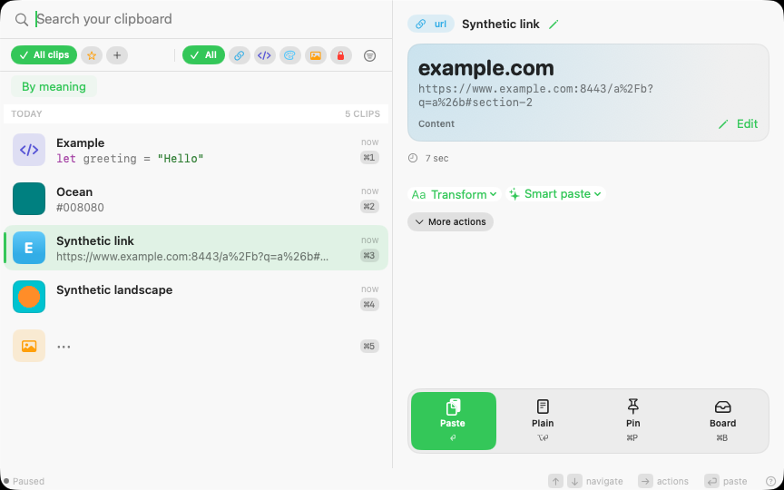
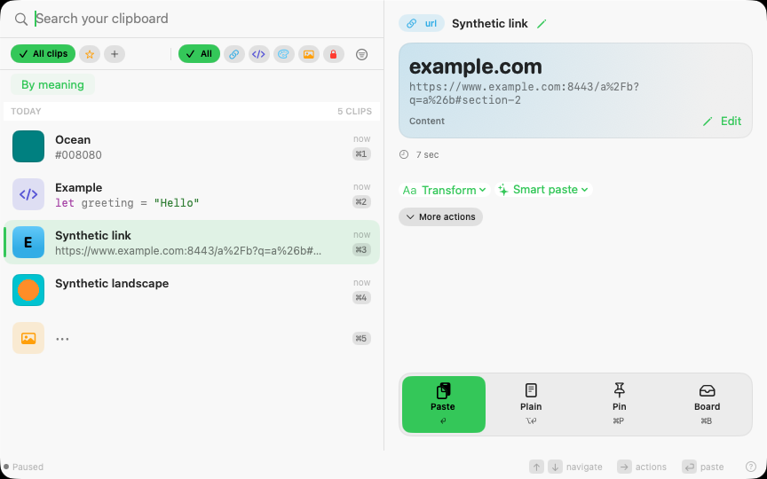
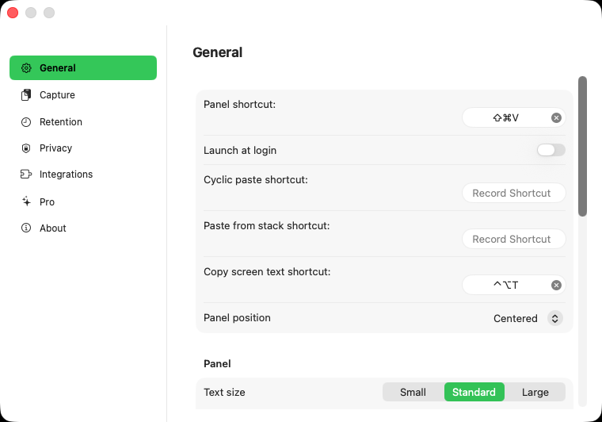
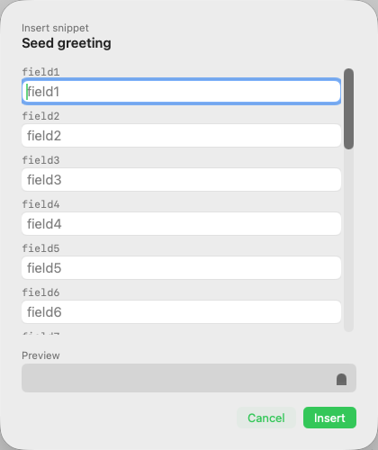
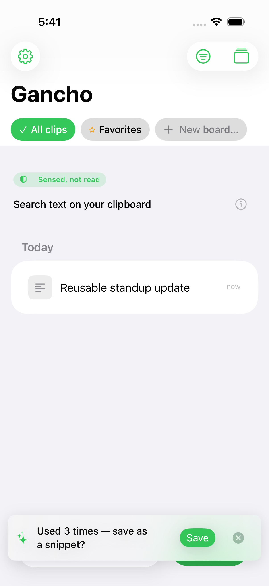

# Application quality review

This review covers the macOS panel, Settings, Library and snippet flows; the
shared search, preview, thumbnail and delivery logic; and iPhone history,
detail and reuse suggestions. Changes preserve the existing product structure,
privacy boundaries, dependency pins, and data formats.

## Flow review

1. **Find and preview a clip — improved.** The panel keeps its system typography,
   list/gallery layouts and keyboard navigation. Custom accent fills now choose
   a legible foreground, compact icon actions share a larger labeled target,
   and footer hints use a stronger semantic foreground. Same-id content changes
   invalidate full previews and thumbnails, including edits that retain the
   deduplication hash. Long-text previews visit the displayed prefix rather
   than counting the entire document first.

   The following comparison uses the same viewport, query and selected synthetic
   link. Capture timing changes the order of the other fixture rows.

   | Baseline | Contrast correction |
   | --- | --- |
   |  |  |

2. **Organize and edit in Library — improved.** Confirmed store mutations refresh
   the open Library through content-free, coalesced events. A fixed 140 ms delay
   no longer guesses when a write completed. A tested browsing model preserves
   loaded pages, rejects superseded reads and offers retry without treating a
   read failure as an empty collection. Snippet drafts retain their independent
   ownership and recovery behavior. Sidebar creation controls use the same
   labeled icon component as the panel.

3. **Navigate Settings — improved.** Each section lives in its own view file;
   section buttons expose selection without changing the existing navigation.
   Imported panel dimensions update their displayed preset. Login registration
   runs only from a user write: reconciling a failure cannot invoke the opposite
   registration action. Failure and approval outcomes have localized feedback.

   

4. **Fill and insert a template — improved.** Fields scroll independently from
   Insert and Cancel, and the sheet follows panel text size. Panel commands stay
   inactive while a dialog owns the keyboard. Template reads remain inside the
   cancellable paste request and revalidate the selected persisted revision both
   before field presentation and before insertion. A changed or removed template
   cannot silently substitute a new body after the user filled its fields.

   

5. **Reuse on iPhone — improved.** The baseline suggestion covered the bottom
   toolbar. Its inset now belongs to the history content inside the navigation
   container, preserving the Paste and search controls. The UI test checks that
   the suggestion and Paste frames do not intersect. iOS pagination rejects old
   pages after refresh/filter changes or cancellation, and in-memory kind filters
   scan the same bounded fallback window as text/app filters.

   

## Other correctness and performance findings

- Eight-digit hex previews now retain alpha instead of forcing opaque colors.
- Thumbnail consumers share one read/decode per persisted revision. Cancelling
  the last consumer releases unused work; cancelling one view cannot cancel
  another visible view's image. Existing FIFO limits remain in place.
- Library failures distinguish invalid saved filters from unavailable storage.
  Metadata read failures retain the previous sidebar instead of publishing zero
  counts or an empty snippet list.
- Settings and Library splits remove their oversized view responsibilities
  without introducing a second persistence or navigation layer.
- Native handoff fixtures establish a content-free seed-readiness boundary on
  disposable hosts. Actual panel opening, paste count, event count, focus,
  process lifetime and quiet-period assertions retain their original budgets.

## Evidence

The fresh baseline was captured from `fb09757` in
[the platform UI run](https://github.com/johnny4young/gancho/actions/runs/38686554212):
iPhone passed 21/21; macOS passed 121 with three existing omissions out of 124.
Two omissions require real Apple signing and the third is the older hosted
status-menu interaction. The separate signed ARM/Intel gate validates the real
external helper, Settings lifecycle and cross-application paste without skips.

The contrast, Settings and long-template images above were captured from
`6e04145` during this audit. They illustrate those changes, rather than claiming
to represent every later source edit. The final head's CI, full UI runs,
signature evidence and scale-budget results are linked in the pull request.
All images are unmodified, inspected captures of synthetic fixtures or Settings
on disposable GitHub hosts; no maintainer desktop or clipboard was captured.

The pull-request interface gate requires fifteen passing cases and zero skips,
including both Settings languages/appearances, panel text sizes, real Library
curation, draft-preserving navigation and the long-template interaction.
Package regressions cover suspended reads with explicit gates, a real encrypted
throwaway store, privacy changes, shared thumbnail cancellation, filters and
color contrast. Assertions and coverage floors remain strict.

## Limits

This is not a full VoiceOver certification or an Instruments/energy profile.
iPad layout was reviewed in source and compiled with the iOS app; interactive
platform evidence comes from an iPhone simulator and the macOS runners. Native
login-item approval is described by the UI but is not registered on the
maintainer's Mac as part of validation. No installation, personal database,
preferences, clipboard, permissions or signing material on that Mac was changed.
